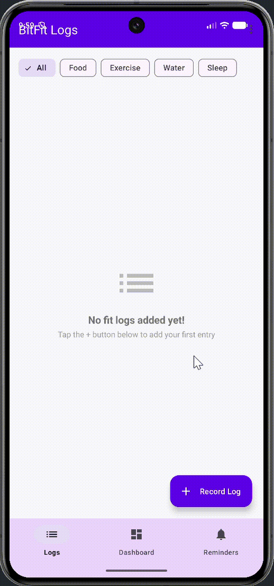

# Android Project 6 - BitFit Part 2

Submitted by: **Marquise**

**BitFit** is a health and fitness tracking Android application that allows users to record, organize, analyze, and track daily fitness, food, water, and sleep metrics persistently in a local database. BitFit Part 2 adds multi-screen fragment navigation, a visual trends dashboard with graphing, and daily reminder notifications.

Time spent: **6** hours spent in total

## Required Features

The following **required** functionality is completed:

- [x] **Use at least 2 Fragments** (`LogListFragment`, `DashboardFragment`, `ReminderFragment`)
- [x] **Create a new dashboard fragment where users can see a summary of their entered data** (Average Calories, Total Calories, Min Calories, Max Calories, and Total Logs)
- [x] **Use one of the Navigation UI Views (BottomNavigation, Drawer Layout, Top Bar) to move between the fragments** (`BottomNavigationView` + `MaterialToolbar` + `NavController`)

The following **optional** features are implemented:

- [x] **Add a more advanced UI (e.g: Graphing) for tracking trends in metrics** (MPAndroidChart line graph plotting calorie trends chronologically)
- [x] **Implement daily notifications to prompt users to fill in their data** (System `AlarmManager` repeating alarm, custom `TimePickerDialog`, notification toggle switch, and instant test notification trigger)

The following **additional** features are implemented:

- [x] **Category Filter Chips**: Filter entries by category (All, Food, Exercise, Water, Sleep) in real time.
- [x] **Clear All Logs with Dialog**: Top toolbar menu action to wipe all logs with confirmation dialog.
- [x] **Individual Log Deletion**: Tap any entry to view full detail screen and delete individual items.
- [x] **Android 13+ Notification Permissions**: Runtime `POST_NOTIFICATIONS` permission handling.

## Video Walkthrough

Here's a walkthrough of implemented user stories:

GIF created with [ScreenToGif](https://www.screentogif.com/)

## Notes

- Integrating MPAndroidChart with Room database Flow / LiveData required sorting log entries chronologically by timestamp before plotting line chart coordinates.
- Setting up system notification channels and `AlarmManager` repeating intents while supporting Android 13+ (`POST_NOTIFICATIONS`) permission requests.

## License

    Copyright 2026 Marquise

    Licensed under the Apache License, Version 2.0 (the "License");
    you may not use this file except in compliance with the License.
    You may obtain a copy of the License at

        http://www.apache.org/licenses/LICENSE-2.0

    Unless required by applicable law or agreed to in writing, software
    distributed under the License is distributed on an "AS IS" BASIS,
    WITHOUT WARRANTIES OR CONDITIONS OF ANY KIND, either express or implied.
    See the License for the specific language governing permissions and
    limitations under the License.
